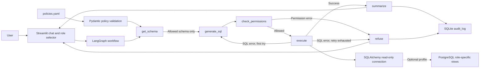
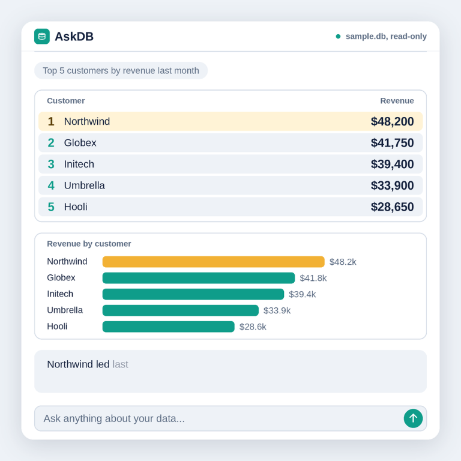

# AskDB

AskDB lets you ask questions in plain English about customer, product, and
order data. It generates SQL using only the selected role's permitted schema,
checks the query before execution, and records each question and authorization
outcome in a local audit table.

## Architecture



## Permission model

`policies.yaml` is loaded and validated with Pydantic on app startup. Each role
defines its permitted tables and columns:

| Role | Tables | Customer email |
|---|---|---|
| Analyst | `customers`, `products`, `orders` | Not allowed |
| Manager | `customers`, `products`, `orders` | Allowed |

The LangGraph workflow runs these steps for each question:

1. Reads only the selected role's allowed schema and passes it to the SQL
   generator.
2. Uses SQLGlot to parse one `SELECT`, reject comments and write statements,
   verify every table and column, qualify identifiers, and expand `SELECT *`
   to only permitted columns.
3. Adds a 100-row limit when one is missing and caps a larger requested limit.
4. Refuses permission violations without retrying. Database execution errors
   may trigger one new SQL-generation attempt with the previous SQL and error.
5. Executes through a read-only SQLite connection by default, with a query
   timeout. The optional PostgreSQL profile also uses read-only roles,
   transactions, and views.
6. Summarizes successful results and chooses a chart when appropriate. The UI
   streams workflow progress as each node runs.
7. Writes each completed workflow to the local `audit_log` table with the
   question, SQL, role, timestamp, outcome (`allowed` or `blocked`), reason,
   and number of SQL attempts.

The role selector is a **local demo control, not authentication**. Anyone who
can use the app can select either role. A production deployment must derive
the role from an authenticated identity and keep database credentials out of
untrusted clients.

## Setup

1. Install Python 3.11 and create a virtual environment:

   ```powershell
   py -3.11 -m venv .venv
   .\.venv\Scripts\Activate.ps1
   ```

2. Install the project dependencies:

   ```powershell
   python -m pip install -r requirements.txt
   ```

3. Create and edit the local environment file:

   ```powershell
   Copy-Item .env.example .env
   ```

   Set `ANTHROPIC_API_KEY` in `.env`. The model defaults to
   `claude-3-5-sonnet-latest`; set `ANTHROPIC_MODEL` to another Claude model
   available to your account if needed.

4. Run AskDB:

   ```powershell
   python -m streamlit run app.py
   ```

The sample SQLite database is seeded automatically on first run. Query
connections use SQLite read-only mode; the separate audit writer records
events in `data/askdb.sqlite3` under the `audit_log` table. Use Streamlit's
**Settings → Theme** menu to switch between light and dark mode.

## Optional PostgreSQL profile

The Compose profile starts PostgreSQL only when requested. It creates analyst
and manager logins that inherit a non-login read-only role. Their search paths
resolve to role-specific views; the analyst `customers` view omits `email`.
The profile seeds a small set of demonstration records.

1. Set `ASKDB_POSTGRES_ADMIN_PASSWORD`, `ASKDB_ANALYST_PASSWORD`, and
   `ASKDB_MANAGER_PASSWORD` in `.env`.
2. Start the database:

   ```powershell
   docker compose --profile postgres up -d
   ```

3. Uncomment and set `ASKDB_ANALYST_DATABASE_URL` and
   `ASKDB_MANAGER_DATABASE_URL` in `.env`, using the corresponding passwords.
   The URLs should use the `postgresql+psycopg` driver and the local host/port,
   for example:

   ```text
   postgresql+psycopg://askdb_analyst:<analyst-password>@localhost:5432/askdb
   postgresql+psycopg://askdb_manager:<manager-password>@localhost:5432/askdb
   ```

4. Run `python -m streamlit run app.py` as usual. Without a PostgreSQL URL,
   AskDB uses the seeded SQLite database.

The Compose profile requires non-empty passwords and does not commit
credentials. The PostgreSQL audit log remains local in the SQLite audit
database.

## Tests

Run the permission, safety, and audit tests with:

```powershell
python -m pytest
```

The tests cover role-specific column access and `SELECT *` expansion, aliased
joins, denied tables/columns, subqueries, comment and multi-statement tricks,
write statements, row limits, and audit records.

## Screenshots and demo




## Example questions

1. Which 10 products have the highest total sales?
2. How many orders were placed in each city?
3. Show monthly revenue for the last 12 months.
4. Who are the top five customers by total spending?
5. Which product categories have the most orders?
